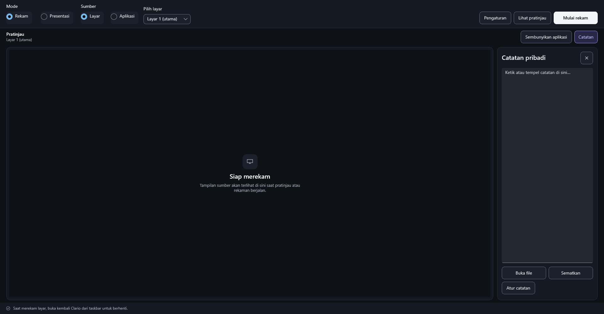

# Clario Presenter

Tampilkan demo di proyektor sambil membaca catatan di laptop. Clario bisa membagikan satu layar atau jendela aplikasi, menyembunyikan jendela pilihan, dan menyimpan tampilan audiens sebagai video MP4.

**[Unduh Clario untuk Windows x64](https://github.com/msaririzki/Clario-Presenter/releases/latest/download/Clario-Presenter-Setup-x64.exe)** · [Catatan rilis](https://github.com/msaririzki/Clario-Presenter/releases/latest) · [Panduan penggunaan](docs/panduan.md)

## Pasang dan mulai

1. Buka installer di Windows 10 versi 2004 (build 19041) ke atas atau Windows 11 dengan prosesor Intel atau AMD 64-bit.
2. Klik **Pasang**, lalu buka **Clario Presenter** dari menu **Mulai**.
3. Pilih mode sesuai kebutuhan.

| Tujuan | Langkah pertama |
| --- | --- |
| Merekam satu layar | Pilih **Rekam → Layar** dan tentukan monitornya. Buka **Sembunyikan aplikasi** untuk memilih jendela pribadi, lalu klik **Mulai rekam**. |
| Presentasi ke proyektor | Tekan **Win+P → Extend (Perluas)** di Windows. Pilih **Presentasi**, tentukan sumber dan **Layar audiens**, lalu klik **Mulai presentasi**. |
| Menampilkan catatan di atas aplikasi | Buka **Catatan**, ketik teks atau buka file Markdown, lalu klik **Sematkan**. Dengan **Klik tembus** aktif, Anda tetap bisa mengeklik aplikasi di belakang catatan. |

Windows dapat menampilkan peringatan SmartScreen untuk installer v1.0.1 karena berkasnya belum ditandatangani dengan sertifikat penerbit. [Cara memeriksa unduhan](docs/panduan.md#pemasangan).

## Kamera, suara, dan hasil rekaman

Clario merekam MP4 H.264 **1920×1080** dengan pilihan **30 atau 60 fps**. Di **Pengaturan**, Anda bisa menambahkan webcam, memilih mikrofon laptop atau USB, dan mencampur suara komputer dengan narasi. Hasil rekaman secara bawaan tersimpan di folder **Video → Clario Presenter**.

**Saat gambar aplikasi disembunyikan, suaranya masih bisa terdengar** jika **Suara komputer** aktif. Gunakan **Privasi** untuk menjeda tampilan audiens dan membisukan rekaman sementara.

## Bantuan dan kontribusi

- [Panduan pengguna](docs/panduan.md) mencakup pemasangan, pengaturan kamera dan mikrofon, serta navigasi catatan panjang.
- [Contoh catatan Markdown](Examples/Praktik-Cisco.md) bisa langsung dibuka lewat **Catatan → Buka file**.
- [Laporkan masalah atau usulkan fitur](https://github.com/msaririzki/Clario-Presenter/issues/new/choose).
- [Panduan kontribusi](CONTRIBUTING.md) menjelaskan cara membangun aplikasi dan menjalankan pengujian.
